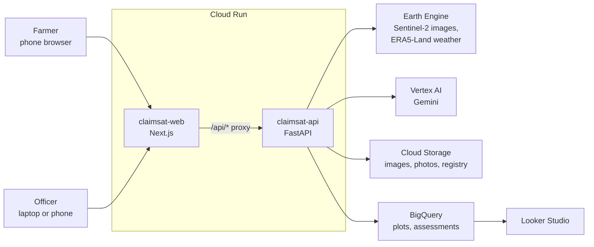

# ClaimSat

**Satellite evidence for crop insurance claims.**

When floods or drought destroy a crop, a PMFBY insurance claim depends on an assessor visiting the field, often days or weeks later, after the evidence has gone. ClaimSat measures the damage from space. An agriculture officer registers each farmer's plot from the land records. After a flood or drought, the farmer enters their Farmer ID, picks their plot and the date, and ClaimSat compares a Sentinel-2 image from about a week before the event with the latest one. The claim is verified in two steps (the satellite images, then an AI check against the weather record), its severity takes into account how many farmers nearby reported the same event, and the farmer gets a report in English and Kannada to attach to the claim. Officers and insurers see damage across a whole village, so they know which fields to visit first.

> ClaimSat provides supporting evidence. It is not an official loss assessment.

Built for the Digital Campus on Google Cloud Hack Sprint, Yenepoya University, 17 October 2026 (FinTech theme).

## How it works

| Who | Where | What they do |
|---|---|---|
| Agriculture officer | `/officer/register` | Outlines a farmer's plot from the land records (survey number). Overlapping outlines and repeated survey numbers are refused. |
| Farmer | `/farmer` | Enters their Farmer ID, picks one of their registered plots, says what happened and when, and gets the case severity, the two-step verification result, before/now images, a bilingual report and an optional photo check. **Farmers can't draw or change a plot**, so nobody can claim for more land than is registered. |
| Officer / insurer | `/officer/dashboard`, Looker Studio | Sees damage on every assessed plot in the village, and a "visit first" list. |

`/` is the landing page with both entry points. `/status` checks the Google Cloud connections.

## Google Cloud services

| Service | What it does in ClaimSat |
|---|---|
| Earth Engine | Sentinel-2 images (the one damage signal): 1 week before vs latest. ERA5-Land weather, used only to verify claims |
| Vertex AI (Gemini) | Step 2 of verification (is the claim plausible given the weather?), the bilingual evidence report, farmer photo checks |
| Cloud Run | Hosts the Next.js web app and the FastAPI service |
| Cloud Storage | Evidence images, field photos (location data removed), assessments, plot registry |
| BigQuery | Every assessment and plot; powers the officer dashboard |
| Looker Studio | Village damage report for insurers |

## Architecture



The browser only talks to the web app; its `/api/*` route forwards to the API, so there are no cross-origin calls and the API's address is set at deploy time.

## Project structure

```
web/       Next.js (App Router, JavaScript) + Tailwind CSS
api/       FastAPI (Python): Earth Engine, Gemini, BigQuery, plot registry
  app/     the service (ee_analysis, scoring, report, photo_check, plots, warehouse…)
  scripts/ find_demo_plots, precompute_demo, batch_village, setup_bigquery, build_samples
  tests/   125 tests, no cloud access needed
shared/    sample_result.json, the API contract between web and api
deploy.sh  deploys both Cloud Run services
DEMO_SCRIPT.md  the 3-minute demo and judge Q&A
```

## Google Cloud setup (one time)

Replace `PROJECT_ID` with your project ID. Install the gcloud CLI first if needed (`brew install --cask google-cloud-sdk`).

```bash
# 1. Sign in and pick the project
gcloud auth login
gcloud config set project PROJECT_ID

# 2. Local credentials for the backend (Earth Engine needs its own scope)
gcloud auth application-default login \
  --scopes=https://www.googleapis.com/auth/cloud-platform,https://www.googleapis.com/auth/earthengine
gcloud auth application-default set-quota-project PROJECT_ID

# 3. Enable APIs
gcloud services enable earthengine.googleapis.com aiplatform.googleapis.com \
  run.googleapis.com cloudbuild.googleapis.com artifactregistry.googleapis.com \
  storage.googleapis.com bigquery.googleapis.com
```

4. **Register the project for Earth Engine (noncommercial use)** at https://code.earthengine.google.com/register. Do this first: no Earth Engine call works until it's approved.

```bash
# 5. Service account for the claimsat-api Cloud Run service
gcloud iam service-accounts create claimsat-api --display-name "ClaimSat API"
SA=claimsat-api@PROJECT_ID.iam.gserviceaccount.com
for role in roles/earthengine.viewer roles/serviceusage.serviceUsageConsumer \
            roles/aiplatform.user roles/bigquery.dataEditor roles/bigquery.jobUser; do
  gcloud projects add-iam-policy-binding PROJECT_ID --member "serviceAccount:$SA" --role "$role"
done

# 6. Storage bucket and BigQuery dataset
gcloud storage buckets create gs://PROJECT_ID-claimsat --location asia-south1 --uniform-bucket-level-access
gcloud storage buckets add-iam-policy-binding gs://PROJECT_ID-claimsat \
  --member "serviceAccount:$SA" --role roles/storage.objectAdmin
bq --location=asia-south1 mk --dataset PROJECT_ID:claimsat
```

## Running locally

```bash
# Backend (terminal 1)
cd api
python3 -m venv .venv && source .venv/bin/activate
pip install -r requirements-dev.txt
cp .env.example .env          # fill in project, bucket, Gemini model and OFFICER_ACCESS_CODE
uvicorn app.main:app --reload --port 8000

# Frontend (terminal 2)
cd web
npm install
cp .env.example .env.local    # API_URL=http://localhost:8000
npm run dev                   # open http://localhost:3000
```

- Demo farmer: **KA-DEMO-001**. Officer pages need the `OFFICER_ACCESS_CODE` from `api/.env`; without it they stay locked.
- Open http://localhost:3000/status to check Earth Engine, Vertex AI and BigQuery; each error says what's missing.
- **Before Google Cloud is set up**, set `NEXT_PUBLIC_MOCK_API=1` in `web/.env.local` to try every screen with sample data. Set it back to `0` once the status page is all green.
- Tests: `cd api && pytest` (no cloud needed) and `cd web && npm run lint && npm run build`.

## Demo-day checklist

Run these from `api/` once `/status` is all green, in this order:

```bash
python -m scripts.setup_bigquery     # tables plots, assessments; views v_dashboard, v_dashboard_latest
python -m scripts.find_demo_plots    # finds real 2019 Krishna-flood fields + a dry control + a 2023 drought field;
                                     # they are registered to KA-DEMO-001 (Ramesh) and KA-DEMO-002 (Suresh)
python -m scripts.precompute_demo    # saves results, images and reports for every demo plot
python -m scripts.batch_village      # ~120 village plots in one Earth Engine pass → BigQuery + dashboard cache
```

With `DEMO_MODE=true` (the deploy script sets it), the API serves those saved results when a live call fails or takes longer than 45 seconds; the UI marks them "Saved demo result". If nothing was precomputed, demo farmer **KA-DEMO-001**'s three sample plots fall back to bundled results clearly marked "Sample data", so the demo never dead-ends. Real farmers' plots never get a fallback.

The three sample plots each show a different rule (built by `python -m scripts.build_samples` with the real scoring code; numbers are illustrative):

| Plot | Story | Outcome |
|---|---|---|
| 112/3 | Flood after very heavy rain; 6 neighbours reported it | Verified, severity **severe** (82) |
| 118/1 | Heavy damage, but nobody nearby reported it | Verified, severity held at **moderate** (60): one report alone can't be severe |
| 124/2 | A "flood" claimed in the dry season; field unchanged | **Not supported**: no damage in the images, no rain in the weather record |

Then deploy (below), open the live URL, and walk through [DEMO_SCRIPT.md](DEMO_SCRIPT.md) once end to end.

## BigQuery and the officer dashboard

Every live assessment is written to BigQuery straight away; a BigQuery failure is logged and never shown to the user. The in-app dashboard is at `/officer/dashboard`. `batch_village` also writes `api/demo_cache/dashboard.json`, which the dashboard falls back to when `DEMO_MODE=true` and BigQuery is unreachable.

### Looker Studio report (for insurers and officers)

1. Open https://lookerstudio.google.com → **Create → Report**.
2. **Add data → BigQuery → My projects →** your project **→ claimsat → v_dashboard_latest → Add**. (One row per plot: its latest assessment.)
3. Check the field types: `geom` should be **Geospatial**, `damage_score` a **Number**, `event_date` a **Date**.
4. **Map:** Add a chart → **Google Maps → Filled map**. *Location* = `geom`, *Color metric* = `damage_score` (aggregation **Max**), *Tooltip* = `survey_number`. In *Style*, colour from green (low) to red (high).
5. **Scorecards:** *Plots assessed* = `Record Count`; *Severe* = `Record Count` filtered `damage_level = severe`; *Moderate* = `Record Count` filtered `damage_level = moderate`; *Hectares affected* = `area_ha` (Sum) filtered `damage_level IN (moderate, severe)`.
6. **Visit-first table:** dimensions `village`, `survey_number`, `farmer_name`, `damage_level`, `confidence`; metric `damage_score` (Max), sorted descending.
7. Optional: a **Drop-down list** on `village` and a **Date range** control on `event_date`.
8. **Share → Manage access.** Viewers need BigQuery access, or set the data source to *Owner's credentials*.

## Deploying to Cloud Run

```bash
./deploy.sh PROJECT_ID 'a-long-random-officer-code' [gemini-model-name]
```

It deploys `claimsat-api` (with `DEMO_MODE=true` and the officer code), reads its URL, then deploys `claimsat-web` pointing at it, and prints the app URL. Check the current Gemini Flash model name in Vertex AI; `/status` shows an error if it's wrong.

## How it measures and verifies a claim

**One satellite: Sentinel-2.** For the registered plot, ClaimSat picks two cloud-free images: the one closest to **1 week before** the event (searching 3–12 days before), and the **latest** one (up to 14 days after, or today). From each image it reads two things:

| Reading | Bands | Meaning |
|---|---|---|
| Crop health (NDVI) | near-infrared vs red (B8, B4) | Healthy plants reflect near-infrared strongly |
| Standing water (MNDWI) | green vs short-wave infrared (B3, B11) | Water absorbs short-wave infrared; MNDWI > 0 = water |

- `ndvi_loss` = (NDVI 1 week before − NDVI now) / max(NDVI before, 0.1), clamped to 0–1.
- `flood_fraction` = share of the plot that is water now but was dry a week before (pixels clear in both images).
- **Damage score (0–100):** flood = 100 × (0.5 × flood_fraction + 0.5 × ndvi_loss); drought and other = 100 × ndvi_loss. **Levels:** none < 15 ≤ low < 35 ≤ moderate < 60 ≤ severe.
- **Confidence:** *high* when both images are ≥ 80% clear, ≤ 21 days apart, the plot is ≥ 20 pixels and was green before (NDVI ≥ 0.4); *low* when an image is missing, the plot is < 10 pixels or there was little crop before (NDVI < 0.2); otherwise *medium*. The reasons are always shown.

**Two-step verification.**
1. *Satellite:* passes if the images show at least low damage with usable confidence.
2. *Weather, checked by AI:* ERA5-Land daily weather for the plot and a 50 km region around it (rain in the week before vs the 10-year normal for those dates, the wettest day, 30-day rain vs normal, the hottest day). A transparent rule gives a first verdict (e.g. flood: ≥ 64.5 mm in a day, IMD's "heavy rain", or a week ≥ 2× normal → supported; under 20 mm in the week → not supported), then Gemini reads the same facts and gives the final verdict with a plain explanation in English and Kannada. River floods from upstream rain are treated as "uncertain", never "fake". Gemini never accuses anyone.

Result: **verified** (both pass), **not supported** (both fail), otherwise **needs review**.

**Case severity.** 70% this plot's damage score + 30% nearby reports: other farmers within **2 km** who reported the same kind of event within **±7 days** (5 or more farmers = full 30). A **single report can't be rated severe** until nearby reports confirm it, and a claim that isn't supported is capped at low.

**Other trust measures:** farmers can't draw plots (officers register them, overlaps refused); every percentage in a Gemini report is checked against the measurements (if Gemini is unavailable, a template writes the report from the same numbers); each report carries a SHA-256 "evidence fingerprint"; photo checks read GPS and date and store only a copy without location data.

## Limitations

- Supporting evidence only. The scores are documented heuristics, not a calibrated loss model, and have not been validated against field assessments.
- Only two images are compared: slow changes such as drought show less, and a harvest in that week can look like damage (the weather check and nearby reports help here).
- Sentinel-2 is optical: thick monsoon cloud can hide the field. Then confidence drops, or the "now" image is missing until a clear day.
- Weather data (ERA5-Land) arrives a few days late, so very recent claims may show the weather step as pending.
- 10 m pixels: very small or narrow plots are less reliable; edges mix with neighbouring land.
- The crop type is as stated by the farmer or officer, not detected.
- The officer access code is a single shared code (fine for a demo, not production). The plot registry stands in for a link to the state land records.
- The three sample plots (`api/app/seed_plots.json`) and the six neighbouring reports (`api/app/seed_reports.json`) are illustrative; real demo fields come from `find_demo_plots`.

## Data sources and attribution

- Copernicus Sentinel-2 data (European Space Agency / European Commission), free and open.
- Cloud Score+ cloud mask for Sentinel-2, Google.
- ERA5-Land daily weather, ECMWF / Copernicus Climate Change Service.
- Map tiles: Esri World Imagery and Esri World Boundaries and Places.

Accessed through Google Earth Engine; see each dataset's page in the Earth Engine catalog for its exact terms.

## Team

_[Team name] · [Member names]_
