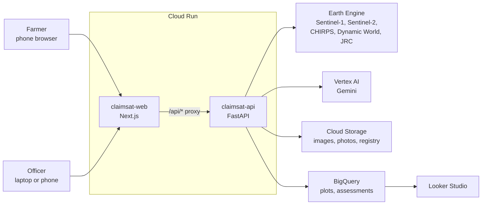

# ClaimSat

**Satellite evidence for crop insurance claims.**

When floods or drought destroy a crop, a PMFBY insurance claim depends on an assessor visiting the field, often days or weeks later, after the evidence has gone. ClaimSat measures the damage from space. An agriculture officer registers each farmer's plot from the land records. After a flood or drought, the farmer enters their Farmer ID, picks their plot and the date, and gets independent, time-stamped satellite evidence with a report in English and Kannada to attach to the claim. Officers and insurers see damage across a whole village, so they know which fields to visit first.

> ClaimSat provides supporting evidence. It is not an official loss assessment.

Built for the Digital Campus on Google Cloud Hack Sprint, Yenepoya University, 17 October 2026 (FinTech theme).

## How it works

| Who | Where | What they do |
|---|---|---|
| Agriculture officer | `/officer/register` | Outlines a farmer's plot from the land records (survey number). Overlapping outlines and repeated survey numbers are refused. |
| Farmer | `/farmer` | Enters their Farmer ID, picks one of their registered plots, says what happened and when, and gets a damage score, evidence images, a bilingual report and an optional photo check. **Farmers can't draw or change a plot**, so nobody can claim for more land than is registered. |
| Officer / insurer | `/officer/dashboard`, Looker Studio | Sees damage on every assessed plot in the village, and a "visit first" list. |

`/` is the landing page with both entry points. `/status` checks the Google Cloud connections.

## Google Cloud services

| Service | What it does in ClaimSat |
|---|---|
| Earth Engine | Sentinel-1 radar flood detection, Sentinel-2 crop health (NDVI), CHIRPS rainfall, Dynamic World cropland, JRC permanent water |
| Vertex AI (Gemini) | Writes the bilingual evidence report; checks farmer photos against the satellite evidence |
| Cloud Run | Hosts the Next.js web app and the FastAPI service |
| Cloud Storage | Evidence images, field photos (location data removed), assessments, plot registry |
| BigQuery | Every assessment and plot; powers the officer dashboard |
| Looker Studio | Village damage report for insurers |

## Architecture



The browser only talks to the web app; its `/api/*` route forwards to the API, so there are no cross-origin calls and the API's address is set at deploy time.

## Project structure

```
web/       Next.js (App Router, JavaScript) + Tailwind CSS
api/       FastAPI (Python): Earth Engine, Gemini, BigQuery, plot registry
  app/     the service (ee_analysis, scoring, report, photo_check, plots, warehouse…)
  scripts/ find_demo_plots, precompute_demo, batch_village, setup_bigquery
  tests/   110 tests, no cloud access needed
shared/    sample_result.json, the API contract between web and api
deploy.sh  deploys both Cloud Run services
DEMO_SCRIPT.md  the 3-minute demo and judge Q&A
```

## Google Cloud setup (one time)

Replace `PROJECT_ID` with your project ID. Install the gcloud CLI first if needed (`brew install --cask google-cloud-sdk`).

```bash
# 1. Sign in and pick the project
gcloud auth login
gcloud config set project PROJECT_ID

# 2. Local credentials for the backend (Earth Engine needs its own scope)
gcloud auth application-default login \
  --scopes=https://www.googleapis.com/auth/cloud-platform,https://www.googleapis.com/auth/earthengine
gcloud auth application-default set-quota-project PROJECT_ID

# 3. Enable APIs
gcloud services enable earthengine.googleapis.com aiplatform.googleapis.com \
  run.googleapis.com cloudbuild.googleapis.com artifactregistry.googleapis.com \
  storage.googleapis.com bigquery.googleapis.com
```

4. **Register the project for Earth Engine (noncommercial use)** at https://code.earthengine.google.com/register. Do this first: no Earth Engine call works until it's approved.

```bash
# 5. Service account for the claimsat-api Cloud Run service
gcloud iam service-accounts create claimsat-api --display-name "ClaimSat API"
SA=claimsat-api@PROJECT_ID.iam.gserviceaccount.com
for role in roles/earthengine.viewer roles/serviceusage.serviceUsageConsumer \
            roles/aiplatform.user roles/bigquery.dataEditor roles/bigquery.jobUser; do
  gcloud projects add-iam-policy-binding PROJECT_ID --member "serviceAccount:$SA" --role "$role"
done

# 6. Storage bucket and BigQuery dataset
gcloud storage buckets create gs://PROJECT_ID-claimsat --location asia-south1 --uniform-bucket-level-access
gcloud storage buckets add-iam-policy-binding gs://PROJECT_ID-claimsat \
  --member "serviceAccount:$SA" --role roles/storage.objectAdmin
bq --location=asia-south1 mk --dataset PROJECT_ID:claimsat
```

## Running locally

```bash
# Backend (terminal 1)
cd api
python3 -m venv .venv && source .venv/bin/activate
pip install -r requirements-dev.txt
cp .env.example .env          # fill in project, bucket, Gemini model and OFFICER_ACCESS_CODE
uvicorn app.main:app --reload --port 8000

# Frontend (terminal 2)
cd web
npm install
cp .env.example .env.local    # API_URL=http://localhost:8000
npm run dev                   # open http://localhost:3000
```

- Demo farmer: **KA-DEMO-001**. Officer pages need the `OFFICER_ACCESS_CODE` from `api/.env`; without it they stay locked.
- Open http://localhost:3000/status to check Earth Engine, Vertex AI and BigQuery; each error says what's missing.
- **Before Google Cloud is set up**, set `NEXT_PUBLIC_MOCK_API=1` in `web/.env.local` to try every screen with sample data. Set it back to `0` once the status page is all green.
- Tests: `cd api && pytest` (no cloud needed) and `cd web && npm run lint && npm run build`.

## Demo-day checklist

Run these from `api/` once `/status` is all green, in this order:

```bash
python -m scripts.setup_bigquery     # tables plots, assessments; views v_dashboard, v_dashboard_latest
python -m scripts.find_demo_plots    # finds real 2019 Krishna-flood fields + a dry control + a 2023 drought field;
                                     # they are registered to KA-DEMO-001 (Ramesh) and KA-DEMO-002 (Suresh)
python -m scripts.precompute_demo    # saves results, images and reports for every demo plot
python -m scripts.batch_village      # ~120 village plots in one Earth Engine pass → BigQuery + dashboard cache
```

With `DEMO_MODE=true` (the deploy script sets it), the API serves those saved results when a live call fails or takes longer than 45 seconds; the UI marks them "Saved demo result". If nothing was precomputed, the two sample plots fall back to a bundled result clearly marked "Sample data", so the demo never dead-ends. Real farmers' plots never get a fallback.

Then deploy (below), open the live URL, and walk through [DEMO_SCRIPT.md](DEMO_SCRIPT.md) once end to end.

## BigQuery and the officer dashboard

Every live assessment is written to BigQuery straight away; a BigQuery failure is logged and never shown to the user. The in-app dashboard is at `/officer/dashboard`. `batch_village` also writes `api/demo_cache/dashboard.json`, which the dashboard falls back to when `DEMO_MODE=true` and BigQuery is unreachable.

### Looker Studio report (for insurers and officers)

1. Open https://lookerstudio.google.com → **Create → Report**.
2. **Add data → BigQuery → My projects →** your project **→ claimsat → v_dashboard_latest → Add**. (One row per plot: its latest assessment.)
3. Check the field types: `geom` should be **Geospatial**, `damage_score` a **Number**, `event_date` a **Date**.
4. **Map:** Add a chart → **Google Maps → Filled map**. *Location* = `geom`, *Color metric* = `damage_score` (aggregation **Max**), *Tooltip* = `survey_number`. In *Style*, colour from green (low) to red (high).
5. **Scorecards:** *Plots assessed* = `Record Count`; *Severe* = `Record Count` filtered `damage_level = severe`; *Moderate* = `Record Count` filtered `damage_level = moderate`; *Hectares affected* = `area_ha` (Sum) filtered `damage_level IN (moderate, severe)`.
6. **Visit-first table:** dimensions `village`, `survey_number`, `farmer_name`, `damage_level`, `confidence`; metric `damage_score` (Max), sorted descending.
7. Optional: a **Drop-down list** on `village` and a **Date range** control on `event_date`.
8. **Share → Manage access.** Viewers need BigQuery access, or set the data source to *Owner's credentials*.

## Deploying to Cloud Run

```bash
./deploy.sh PROJECT_ID 'a-long-random-officer-code' [gemini-model-name]
```

It deploys `claimsat-api` (with `DEMO_MODE=true` and the officer code), reads its URL, then deploys `claimsat-web` pointing at it, and prints the app URL. Check the current Gemini Flash model name in Vertex AI; `/status` shows an error if it's wrong.

## How the damage score works

All measurements are means over the registered plot at 10 m resolution. Event date = E.

| Measurement | How |
|---|---|
| Crop health (NDVI) | Cloud-masked Sentinel-2 (Cloud Score+ ≥ 0.6). Before: E−30 to E−1 days; after: E+5 to E+30. Baseline: the same "after" weeks in each of the previous 3 years. |
| `ndvi_loss` | (baseline − after) / max(baseline, 0.1), clamped to 0–1: the share of *normal* crop health that is missing, so a normal harvest isn't counted as damage. |
| `flood_fraction` | Share of the plot where post-event Sentinel-1 VV < −16 dB **and** it dropped by more than 3 dB, excluding permanent water (JRC occurrence > 50%). |
| `rain_deficit` | 1 − season rain / 20-year mean for the same window (CHIRPS), clamped to 0–1. Droughts only. |

**Damage score (0–100):** flood = 100 × (0.5 × flood_fraction + 0.5 × ndvi_loss); drought = 100 × (0.6 × ndvi_loss + 0.4 × rain_deficit); other = 100 × ndvi_loss. If a part is missing, the others are re-weighted and confidence drops. **Levels:** none < 15 ≤ low < 35 ≤ moderate < 60 ≤ severe.

**Confidence:** *high* needs ≥ 3 cloud-free images before and after, ≥ 20 pixels, ≥ 60% cropland and (for floods) radar on both sides; *low* if there are no usable images (and no radar), < 30% cropland or < 10 pixels; otherwise *medium*. The reasons are always shown.

**Trust measures:** Gemini only writes words; every percentage it writes is checked against the measurements (one retry, then the report is flagged). Each report carries a SHA-256 "evidence fingerprint" of the measurements. Photo checks read the photo's GPS and date and flag photos > 200 m from the plot, without a location or date, before the event or > 60 days after; only a resized copy without location data is stored.

## Limitations

- Supporting evidence only. The score is a documented heuristic, not a calibrated loss model, and it has not been validated against field assessments.
- 10 m pixels: very small or narrow plots are less reliable; edges mix with neighbouring land.
- Optical images need clear skies; monsoon floods rely mostly on radar.
- The crop type is as stated by the farmer or officer, not detected.
- The officer access code is a single shared code (fine for a demo, not production). The plot registry stands in for a link to the state land records.
- The two sample plots (`api/app/seed_plots.json`) are placeholders near Athani town, not real farmland; the real demo fields come from `find_demo_plots`.

## Data sources and attribution

- Copernicus Sentinel-1 and Sentinel-2 data (European Space Agency / European Commission), free and open.
- CHIRPS daily rainfall, Climate Hazards Center, UC Santa Barbara.
- Dynamic World land cover, Google and World Resources Institute.
- JRC Global Surface Water, European Commission Joint Research Centre.
- Cloud Score+ cloud mask, Google.
- Map tiles: Esri World Imagery and Esri World Boundaries and Places.

Accessed through Google Earth Engine; see each dataset's page in the Earth Engine catalog for its exact terms.

## Team

_[Team name] · [Member names]_
